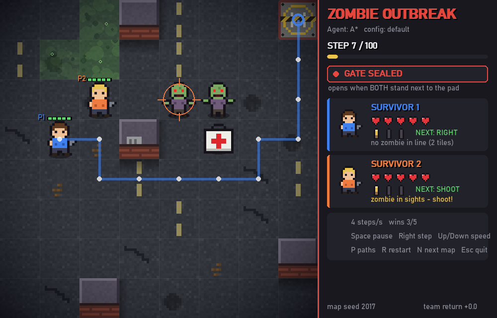

# Zombie Outbreak: World Models for Intelligent Game Agents



Two survivors must escape a zombie-infested city block together. Infection spreads tile by tile and zombies hunt the survivors. The evacuation gate opens only when **both** survivors stand next to the helipad.

This is a course project on **learning to play by imagining**. Can an agent learn a model of the game world, imagine future states with it, and make better decisions than conventional agents? We compare:

| # | Agent | Idea | Status |
|---|---|---|---|
| 1 | **A\*** | Plans a route on the current map each step; one planner per survivor | ✅ done |
| 2 | **Q-learning** | Two independent tabular learners sharing a team reward | ⬜ |
| 3 | **True-dynamics MPC** | Random-shooting planner over joint actions using the real simulator | ⬜ |
| 4 | **Learned-model MPC** | The same planner, imagining futures with a learned (STORM-inspired) world model | ⬜ |
| 5 | **Uncertainty-aware MPC** | Agent 4 plus an ensemble-disagreement penalty (our improvement) | ⬜ |

Base paper: *STORM: Efficient Stochastic Transformer based World Models for Reinforcement Learning* (Zhang et al., NeurIPS 2023), simplified to a grid-state CNN world model with MPC. Full spec: [`Requirements.md`](Requirements.md).

---

## Quick start

```bash
python -m venv .venv
.venv/Scripts/activate              # Windows   (Linux/macOS: source .venv/bin/activate)
pip install -e ".[dev,model]"
pytest -q                           # rule, determinism, agent and render tests
python scripts/play.py              # play it yourself
```

> Name the virtual environment `.venv`, **not** `env`. `env/` is the game package.

## Play it yourself (2 players, one keyboard)

```bash
python scripts/play.py --seed 0
```

| | Move | Shoot | Wait |
|---|---|---|---|
| **Survivor 1** (blue) | Arrow keys | Space | Enter |
| **Survivor 2** (orange) | W A S D | F | Q |

Turns are **simultaneous**: the game advances once both players have chosen an action. R restarts, N loads the next map, Esc quits. Use `--cell 64` for a smaller window.

## Watch an agent play

```bash
python scripts/watch.py --agent astar --seed 2000 --auto
```

The agent controls both survivors, and each survivor's planned route is drawn on the map.

| Key | Action |
|---|---|
| Space | Pause / resume |
| → | Advance one step while paused |
| ↑ / ↓ | Change speed |
| P | Show / hide routes |
| N | Next map |
| R | Restart map |

## Game rules

| | |
|---|---|
| **Map** | 8x8 city grid, procedurally generated from a seed. Buildings are walls. A route to the exit is guaranteed at the start. |
| **Survivors** | 2, each with health 0–5 and ammo 0–3 |
| **Actions** | Up, down, left, right, wait, shoot (per survivor, so 36 joint actions) |
| **Shooting** | Kills the nearest zombie in a straight line within 2 tiles. Walls block shots. Costs 1 ammo. |
| **Zombies** | Scripted. Each step a zombie chases the nearest survivor with probability 0.7, otherwise wanders. |
| **Infection** | Spreads to neighbouring tiles each step. Standing on it costs 1 health. |
| **Damage** | −1 health per step on an infected tile, and −1 per step next to a zombie |
| **Pickups** | Medkit gives +2 health. **If your partner is next to you, it heals both of you.** Ammo crate gives +1 ammo. Supplies drop every 10 steps. |
| **Gate** | Opens only when **both** survivors are within 1 tile of the helipad. Step onto the open pad to evacuate. |
| **Death** | A survivor at 0 health is down for good; the partner can still escape alone. |
| **End** | Both escape → **win**. One escapes → **partial**. Both die, or 100 steps pass → **loss**. |
| **Reward** | Shared team reward: +20 both escape, +10 one escapes, −10 per death, −1 per damage, +2 per kill, +1 per pickup, −0.1 per step |

The exact step order and edge cases are in [`docs/interfaces.md`](docs/interfaces.md).

## Run experiments (headless)

```bash
python -m experiments.run_benchmark --agent astar --split test                          # Exp 1
python -m experiments.run_benchmark --agent astar --split test --config no_coord        # coordination ablation
python -m experiments.run_benchmark --agent astar --split shifted --config infection_2p --exp exp6
```

Each run plays one full game per map seed in the split and writes one CSV row per game to `results/`. Columns include return, success, steps, deaths, damage, kills and ms per decision.

**Map splits** (`--split`), defined in `experiments/seeds.py`:

| Split | Seeds | Use |
|---|---|---|
| `train` | 0–999 | Training learning agents and collecting world-model data |
| `val` | 1000–1099 | Tuning |
| `test` | 2000–2099 | Final reported numbers |
| `shifted` | 3000–3099 | Generalization tests (Exp 6) |

**Rule variants** (`--config`), defined in `env/config.py`:

| Config | What changes |
|---|---|
| `default` | The normal game |
| `no_coord` | Cooperation rules off: gate always open, medkits heal one survivor (ablation) |
| `infection_2p` | Infection spreads twice as fast |
| `more_zombies` | 5 zombies instead of 3 |
| `faster_zombies` | Zombies move twice per step |
| `fewer_supplies` | No starting items; supply drops every 25 steps |
| `dense_walls` | 25% walls instead of 15% |

### Results so far (validation maps, 100 games)

| Agent | Both escape | One escapes | Both die | Return | Steps | ms / decision |
|---|---|---|---|---|---|---|
| Random | 0% | 0% | 99% | −30.7 ± 1.4 | 18 | <0.1 |
| A\* | 46% | 40% | 14% | 4.2 ± 17.6 | 21 | 0.4 |

## Project layout

```
env/            the game, pure NumPy (no pygame)
  config.py       EnvConfig, action/channel constants, shifted + ablation configs
  outbreak_env.py OutbreakEnv: Gymnasium API, step rules, get_state/set_state/clone
  map_gen.py      seeded map generation + BFS reachability
  state_encoding.py  full grid tensor, Q-learning features, world-model input
  sprites.py      pixel-art sprite data
  render_pygame.py   Renderer: sprites, animation, effects, HUD (drawing only)
agents/         base (Agent API), random_agent, astar_agent, [qlearning, mpc_planner]
world_model/    [dataset, model, train, eval_prediction, rollout]
experiments/    seeds, harness (evaluation + CSV), run_benchmark, [generalization, accuracy_vs_decision]
analysis/       [plots, tables]
scripts/        play, watch, make_assets, [collect_data, demo_side_by_side]
assets/         PNG sprites (reskinnable)
tests/          rule, determinism, A* and render tests
results/        experiment CSVs and figures
docs/           interfaces.md (frozen contracts), progress.md (status + handoff log), images/
report/         report and slides
```
`[...]` = planned.

## For contributors

- **Start with [`docs/progress.md`](docs/progress.md)** for the current status, who owns what, and open decisions. Add an entry at the end of each work session.
- **[`docs/interfaces.md`](docs/interfaces.md)** holds the agreed contracts: env API, action ids, tensor shapes, step order, dataset and CSV formats. Don't change them without telling the team.
- **Game logic stays in `env/` and stays pygame-free.** Every rule change needs a test in `tests/test_rules.py`.
- **New agents** subclass `agents.base.Agent`, return a joint action `(a1, a2)`, and get registered in `agents/__init__.py` so `watch.py` and `run_benchmark.py` can use them.
- **All seeds come from `experiments/seeds.py`.**

## Assets

All sprites are original pixel art, generated from `env/sprites.py` and saved to `assets/*.png` (16x16; HUD icons 8x8). To reskin the game, edit or replace a PNG and keep its file name. Delete it to fall back to the built-in sprite, or run `python scripts/make_assets.py --force` to regenerate all of them.

## References

- Zhang et al., *STORM: Efficient Stochastic Transformer based World Models for Reinforcement Learning*, NeurIPS 2023. [arXiv:2310.09615](https://arxiv.org/abs/2310.09615)
- Chua et al., *Deep Reinforcement Learning in a Handful of Trials using Probabilistic Dynamics Models* (PETS), NeurIPS 2018
- Yu et al., *MOPO: Model-based Offline Policy Optimization*, NeurIPS 2020
- Hafner et al., *Mastering Diverse Domains through World Models* (DreamerV3), context only

_Citations to be verified before the final report._
